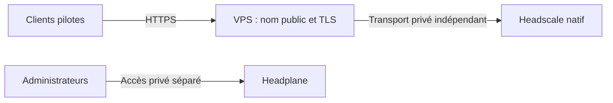

# Plan de migration progressive Tailscale vers Headscale

Document préparatoire du 29 octobre 2026. **Aucune bascule de client de production
n'a été effectuée.** Toute exposition distante, modification de route ou migration
reste soumise à un accord distinct.

## Situation de départ et limites de l'inventaire

Le Tailscale officiel de `B550-GAMING-X-V2` fonctionne avec le serveur
`https://controlplane.tailscale.com`, version 1.104.2, IP `100.121.43.68`, suffixe
MagicDNS `tailc6d37b.ts.net`. L'hôte accepte le DNS officiel, n'accepte pas les
routes annoncées, n'annonce pas de sous-réseau et n'utilise pas d'Exit Node.
Tailscale SSH est activé sur cet hôte : sa migration est donc particulièrement
sensible pour l'accès d'administration.

Les pairs visibles au moment de l'audit sont les suivants. Cet inventaire local
ne remplace pas celui de la console officielle : des ACL peuvent masquer des
clients et les appareils absents ou hors ligne doivent être recensés séparément.

| Client                                     | OS observé | IPv4 officielle | État lors du relevé |
| ------------------------------------------ | ---------- | --------------- | ------------------- |
| b550-gaming-x-v2                           | Linux      | 100.121.43.68   | En ligne            |
| zabbix                                     | Linux      | 100.123.195.23  | En ligne            |
| hunthethreat                               | Linux      | 100.122.19.127  | En ligne            |
| shuffle                                    | Linux      | 100.115.162.101 | En ligne            |
| thehive                                    | Linux      | 100.101.29.127  | En ligne            |
| DESKTOP-C7MR45U                            | Windows    | 100.75.215.91   | En ligne            |
| AXILAP10-W11                               | Windows    | 100.98.138.123  | Hors ligne          |
| bughunter-web                              | Linux      | 100.87.169.83   | En ligne            |
| iPhone 12 mini, HostName local `localhost` | iOS        | 100.98.19.11    | Hors ligne          |
| wazuh                                      | Linux      | 100.117.187.98  | En ligne            |
| thinkpad                                   | Linux      | 100.106.8.127   | Hors ligne          |

Le fichier privé `../headplane-native-setup/tailscale-inventory.json` conserve
les noms DNS, IPv6, routes et préférences sélectionnées, sans clé d'authentification.
Les IP et les noms ci-dessus sont un instantané, pas une promesse de conservation
des adresses après migration.

Les six conteneurs Tailscale suivants ont également été interrogés en lecture seule :

| Conteneur                           | Tag annoncé      | DNS accepté | Routes acceptées | Routes annoncées |
| ----------------------------------- | ---------------- | ----------- | ---------------- | ---------------- |
| tailscale-zabbix                    | tag:zabbix       | Non         | Non              | Aucune           |
| tailscale-wazuh                     | tag:wazuh        | Non         | Non              | Aucune           |
| tailscale-thehive                   | tag:thehive      | Non         | Non              | Aucune           |
| tailscale-shuffle                   | tag:shuffle      | Non         | Non              | Aucune           |
| tailscale-hunthethreat              | tag:hunthethreat | Non         | Non              | Aucune           |
| bughunter-web-tailscale-bughunter-1 | tag:bughunter    | Non         | Non              | Aucune           |

Ils emploient tous le serveur officiel, sans Exit Node sélectionné. Aucun pair
visible ne se déclarait Exit Node ou routeur de sous-réseau. Cela ne prouve pas
l'absence de routeurs dans les autres parties du tailnet : confirmer dans la
console officielle avant de préparer la bascule.

## Dépendances à relever avant toute décision

Pour chaque client, consigner propriétaire, version réelle, OS, mode de démarrage,
identité, tags, ACL, Tailscale SSH, DNS accepté, routes et Exit Nodes. Relever
les accès entrants et sortants, les tâches planifiées, intégrations et URL codées
en dur dans les applications.

Points particuliers au homelab :

- Wazuh publie 1514/1515 sur l'IP Tailscale de l'hôte. Les agents qui utilisent
  cette IP perdraient leur destination si elle changeait.
- Les façades Wazuh, TheHive et Shuffle utilisent des conteneurs Tailscale et des
  réseaux frontend distincts ; inventorier aussi leurs configurations Serve,
  Funnel éventuel, TLS et proxy avant de modifier un conteneur.
- BugHunter et HuntTheThreat utilisent leurs propres réseaux Docker, proxies,
  états Tailscale et noms DNS. Cartographier les dépendances entre ces services,
  les bases et les autres clients.
- Les règles `ts-input`, `ts-forward`, `DOCKER-USER` et les services de supervision
  du pare-feu dépendent de cette architecture. Leur adaptation nécessite une
  étude séparée ; ne pas supprimer les règles pour résoudre un incident.
- Exporter et faire relire la politique du tailnet officiel, les groupes, tags,
  auto-approvers, restrictions SSH et propriétaires de tags. Cette politique
  n'a pas été récupérée : le client local ne fournit pas un export complet.
- Inventorier les noms `*.tailc6d37b.ts.net`, certificats liés, bookmarks,
  webhooks et URL des API. Le nouveau MagicDNS ne conserve pas automatiquement
  les noms du service officiel.

Trois conteneurs frontend et deux unités SOC étaient déjà dans un état non
opérationnel au premier audit. Stabiliser et tester la chaîne de production avant
une migration ; ce document ne traite pas leur réparation.

## Architecture distante à décider ultérieurement

Aujourd'hui Headscale écoute sur `127.0.0.1:8085`, avec cette même boucle locale
dans `server_url`. Seul son agent local peut utiliser cette URL. Headplane est en
HTTPS sur le LAN, pas un point de coordination distant.

Choisir un nom public stable appartenant réellement à l'opérateur, par exemple
un sous-domaine de coordination et un autre nom d'administration. Vérifier la
possession du domaine, la stratégie DNS, les certificats, le renouvellement et
les mécanismes de supervision. Les noms `example.net` ci-dessous sont fictifs.

| Option                   | Intérêt                                                  | Conditions et risques à étudier                                                                                                            |
| ------------------------ | -------------------------------------------------------- | ------------------------------------------------------------------------------------------------------------------------------------------ |
| Entrée HTTPS au domicile | Coordination et données restent sur l'hôte               | IP publique ou DNS dynamique, CGNAT éventuel, redirection de port, disponibilité du domicile, cloisonnement des API                        |
| VPS comme entrée HTTPS   | Adresse publique stable sans ouvrir directement l'hôte   | Coût et maintenance du VPS, tunnel de transport indépendant du VPN en cours de migration, protection des API, disponibilité du lien retour |
| Headscale sur VPS        | Coordination indépendante de la disponibilité du homelab | Transfert d'identité explicitement approuvé, sauvegardes hors VPS, séparation du plan de données et de l'administration                    |

La variante VPS point d'entrée peut suivre ce principe :



Éviter un tunnel vers Headscale qui dépend exclusivement des clients Tailscale
que l'on souhaite déplacer. Sans canal indépendant, la bascule peut couper
l'accès à son propre serveur de coordination.

Un reverse proxy doit supporter les connexions et mises à niveau de protocole
requises par Headscale et ses clients. Les exemples du site Headscale sont
documentés comme communautaires : les tester sur la version retenue avant usage.
L'API REST `/api` doit rester privée ; le socket CLI, les métriques et gRPC ne
doivent pas être publiés. Examiner précisément les chemins nécessaires à la
coordination et au DERP avant d'appliquer des restrictions de proxy.
[Référence reverse proxy Headscale](https://headscale.net/stable/ref/integration/reverse-proxy/)

Préparer une matrice distincte des ports : HTTPS de coordination, transport direct
WireGuard des clients, relais DERP et STUN si un relais est hébergé. Un proxy HTTP
ne relaie pas le STUN UDP. Un DERP personnel peut être hébergé au domicile ou sur
VPS ; mesurer la latence et prévoir ses mises à jour. Conserver des relais publics
ou valider la disponibilité des relais privés avant de retirer les premiers.
Le DERP intégré est désactivé dans l'installation actuelle.
[Référence DERP Headscale](https://headscale.net/stable/ref/derp/)

Revoir séparément les règles du routeur, NAT, CGNAT, IPv6 et pare-feu. Un domaine
et un certificat n'établissent pas à eux seuls la connectivité. Ne pas rendre
Headplane public pour rendre Headscale accessible aux clients.

## Stratégie progressive

1. **Accès de secours obligatoire.** Vérifier une connexion console ou SSH LAN
   utilisable sans aucun VPN. Pour un poste distant, prévoir une console hors
   bande ou une personne sur place. Tester réellement cet accès.
2. **Inventaire complet.** Exporter les préférences et la politique officielles,
   relever les dépendances et confirmer tous les routeurs, tags et noms DNS.
3. **Préproduction distante.** Concevoir et approuver domaine, TLS, proxy, filtrage,
   DERP et sauvegardes. Tester avec une instance et des identités de laboratoire.
   Ne pas activer en parallèle deux serveurs avec la même base ou clé Noise.
4. **Premier pilote distinct.** Utiliser une VM ou un appareil sans rôle critique,
   avec une nouvelle identité et une clé d'inscription à durée courte. Ne pas
   utiliser `B550-GAMING-X-V2` ni les conteneurs Tailscale de production comme pilote.
5. **Deuxième pilote distinct.** Vérifier le trafic autorisé et refusé entre deux
   clients, les DNS et le relais lorsque la connexion directe est impossible.
6. **Pilote Subnet Router séparé.** Préparer un nœud dédié, un sous-réseau de test
   étroit, les règles de forwarding et ACL nécessaires, puis tester l'approbation
   de route. Éviter de reprendre immédiatement tout `192.168.0.0/24`, les bridges
   Docker ou une route par défaut.
7. **Service peu critique.** Après observation et accord, déplacer un seul service,
   adapter ses URL et sa supervision, puis vérifier ses dépendances depuis les
   deux environnements. Garder une fenêtre et un rollback documentés.
8. **Lots contrôlés.** Déplacer les autres services un par un, avec tests métier
   et observation entre les lots. Migrer l'hôte d'administration et les routeurs
   critiques en dernier, avec accès de secours déjà vérifié.
9. **Retrait final.** Retirer les anciennes identités, clés et configurations
   officielles seulement après stabilisation et accord explicite. Conserver les
   sauvegardes selon une politique de rétention approuvée.

## Reconfiguration des clients

Un client Tailscale ne change pas de serveur de coordination grâce à une simple
modification DNS : il doit être reconfiguré et réauthentifié auprès de Headscale.
Ses adresses et son identité dans le nouveau réseau peuvent changer.

Sur un **nouveau pilote Linux uniquement**, un futur exemple, à adapter après
validation du serveur HTTPS et des préférences du pilote, serait :

```bash
# Exemple de plan, jamais exécuté sur l'hôte ou les conteneurs de production.
sudo tailscale up \
  --login-server=https://coordination.example.net \
  --auth-key=file:/chemin/prive/cle-pilote \
  --accept-dns=false \
  --accept-routes=false
```

Le fichier de clé doit être privé et ne pas être placé dans Git, une URL, une
variable de commande visible ou un journal. Préférer une clé non réutilisable,
à durée courte et aux tags limités. Ne pas employer `--reset` pour contourner
les contrôles des préférences : `tailscale up` exige de redonner l'ensemble des
options non standard lorsque l'on modifie une configuration existante.
[Référence officielle `tailscale up`](https://tailscale.com/docs/reference/tailscale-cli/up)

Sur Windows, macOS et iOS, préparer les procédures propres à la version du client
et aux mécanismes d'administration de l'appareil. Les tester sur un appareil
de laboratoire ; ne pas présumer que le flux Linux s'applique tel quel.
Pour Docker, modifier la source gérée Compose/variables seulement lors de la
fenêtre approuvée, et utiliser de nouveaux fichiers d'état pour les pilotes.
Ne pas partager un volume d'état entre deux clients actifs.

Les fonctions propres au service Tailscale officiel — identité, gestion de
certificats, partage, Serve/Funnel, SSH et autres capacités — doivent être évaluées
individuellement. Ne pas promettre une parité complète avant tests.

## Tests exigés avant une bascule

- Résolution du domaine, certificat valide et renouvellement testable depuis un
  réseau extérieur, sans désactivation de TLS.
- Endpoint de santé, administration privée, refus d'un accès API non autorisé.
- Inscription par clé et procédure interactive si prévue ; expiration et révocation.
- Redémarrage du serveur et des deux clients ; persistance et reconnexion.
- Communications autorisées, refus des flux non autorisés, tags et isolation.
- Connexion directe, puis connexion via DERP sur un réseau restrictif.
- MagicDNS, DNS local du homelab et absence de conflit avec le réseau officiel.
- SSH standard et Tailscale SSH seulement si leur usage est retenu et validé.
- Routes étroites du pilote, retour du trafic, absence de boucle, puis suppression
  de la route test. Exit Node seulement dans une phase séparée.
- Services métier : agents et tableau Wazuh, TheHive, Shuffle, BugHunter et
  HuntTheThreat, y compris leurs intégrations réciproques.
- Sauvegarde, restauration hors ligne et rollback chronométré depuis un accès
  indépendant. Aucun test ne doit nécessiter de perdre le seul canal d'administration.

## Rollback d'un pilote ou d'un lot

Avant chaque déplacement, conserver hors du canal migré : préférences originales,
version du client, configuration gérée, état privé, noms DNS, routes, ACL et moyen
de réauthentification officiel. Protéger les fichiers d'état comme des secrets.

En cas d'échec, utiliser l'accès de secours, arrêter le seul client pilote ou
service concerné, rétablir sa configuration officielle et ses préférences exactes,
puis le réauthentifier si nécessaire. Ne jamais faire tourner deux démons sur
la même copie d'état. Restaurer également les URL, dépendances DNS et règles
propres au lot, puis vérifier depuis un autre appareil que le chemin officiel
est réellement revenu.

Le retour au serveur `https://controlplane.tailscale.com` ne garantit pas à lui
seul le retour de l'ancienne IP : vérifier l'identité et la réinscription dans la
console officielle. Ne supprimer aucune ancienne identité avant ce contrôle.
En cas de modification du schéma de base Headscale, utiliser sa sauvegarde
compatible ; changer seulement le binaire ne constitue pas un rollback de base.

## Décisions encore nécessaires

Propriété du domaine, emplacement futur de la coordination, besoin d'un VPS,
architecture DERP, politique officielle à transposer, inventaire complet des
clients et routes, procédures Windows/iOS, mécanisme SSO/MFA futur, stratégie
de sauvegarde hors hôte et accès de secours de chaque machine.

Cette phase a installé et testé les services natifs locaux. Elle n'a changé
aucun client de production, aucune ACL officielle, aucune route de production,
aucun proxy existant ni aucune exposition WAN.
